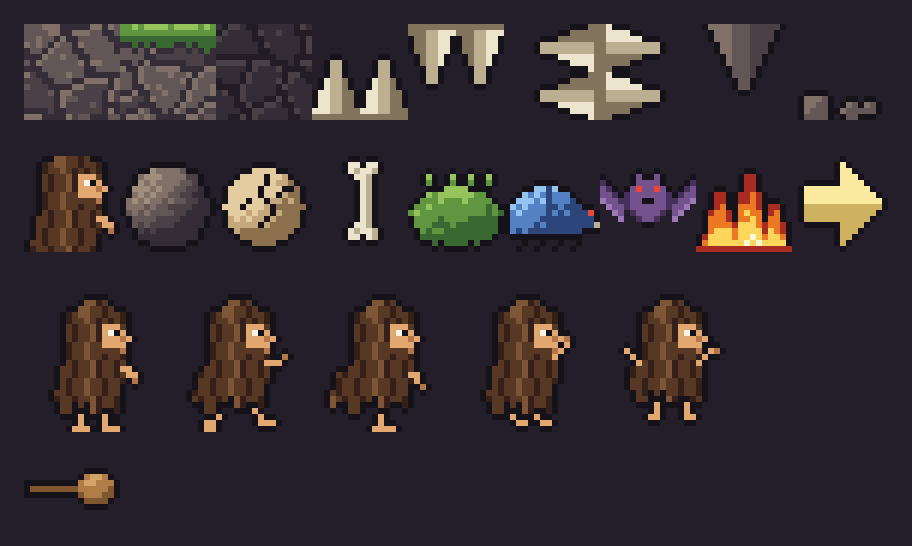

# cROCK

Platformer 2D de precisión: Crock, un cavernícola melenudo con una porra que,
en lugar de doble salto, **golpea objetos para impulsarse**. Ver [docs/ROADMAP.md](docs/ROADMAP.md).

Estado: Fases 0–2 hechas; **Fase 3**: capítulo 1 jugable (5 salas en Tiled), enemigos, pinchos, fuego, muerte y reinicio instantáneo, pixel art y cámara.



## Estructura

| Ruta | Qué es |
|---|---|
| `crates/sim` | Simulación determinista, sin SDL ni reloj: `step(&mut World, &Input)` a 240 Hz fijos. Tests incluidos. |
| `crates/crock` | Capa de plataforma SDL3: ventana, bucle, entrada (teclado + mando), render interpolado con cámara, HUD, métricas. |
| `tools/solver` | Solver de salas: busca una ruta hasta la salida y la guarda como repetición. |
| `tools/gen_art.py`, `tools/ascii2tmj.py` | Generador del pixel art y conversor de bocetos ASCII a Tiled. |
| `assets/tuning.cfg` | Constantes de movimiento; **se recargan en caliente** al guardar. |
| `assets/levels/` | Salas de Tiled (`.tmj`), tilesets (`.tsj`) y capítulos (`capituloN.txt`). Ver [docs/NIVELES.md](docs/NIVELES.md). |
| `assets/gfx/` | Pixel art (16 px por tile, doble resolución que la física). |
| `assets/replays/` | Una ruta por sala, encontrada por el solver; los tests comprueban que siguen funcionando. |

## Compilar y jugar

SDL3 se compila desde fuente y se enlaza en estático (hace falta `cmake` y un
compilador de C). En Linux, además, las cabeceras de X11/Wayland/audio:

```bash
sudo apt install cmake libx11-dev libxext-dev libxcursor-dev libxi-dev libxrandr-dev libxss-dev libxfixes-dev libxtst-dev libwayland-dev libxkbcommon-dev libegl-dev libasound2-dev libpulse-dev libudev-dev libdbus-1-dev
```

```bash
cargo run --release -p crock
```

Opciones: `--vsync=on|adaptive|off`, `--fps=N` (limitador), `--fullscreen`
(exclusiva), `--chapter=N|nombre`, `--room=N`, `--overlay`. Grabar y
reproducir partidas:
`--record=partida.rep` (guarda al salir, desde el último reinicio) y
`--replay=partida.rep`. Para pruebas automáticas: `--frames=N`, `--autoplay`,
`--screenshot=out.bmp`.

```bash
cargo run --release -p crock -- --chapter=1 --room=3 --replay=assets/replays/c1-03-el-foso.rep
```

Una repetición sólo es válida con la misma sala y las mismas constantes con
las que se grabó.

```bash
cargo test --workspace
```

## Controles

| Acción | Teclado | Mando |
|---|---|---|
| Mover | Flechas / WASD | Cruceta / stick izquierdo (8 direcciones) |
| Saltar (mantener = más alto) | Espacio / C / Z / K | A (botón sur) |
| Golpear con la porra (en la dirección pulsada) | X / J / Shift izq. | X (botón oeste) / RB |
| Reiniciar | R | |
| Overlay de métricas | F1 | |
| Modo de presentación (vsync → adaptativo → inmediato) | F2 | |
| Limitador de fps (no, 60, 120, 144, 240, 360) | F3 | |
| Retardo antes de leer la entrada (0–8 ms) | F4 | |
| Recargar capítulo (desde disco) / siguiente capítulo | F5 / F6 | |
| Sala anterior / siguiente | F7 / F8 | |
| Ventana → sin bordes → exclusiva | F11 / Alt+Enter | |

## El golpe (Fase 2)

Golpear un objeto lanza al troglodita en la dirección **opuesta** a la del
golpe, a velocidad fija, durante un instante sin gravedad; luego la física
normal. La dirección (8) se fija en el instante de pulsar; sin dirección, golpea
hacia donde mira. Si al pulsar no hay nada a tiro, el golpe sigue activo
`strike_window` segundos y conecta si algo entra en la caja; si no, falla y hay
un breve enfriamiento. Un golpe pulsado durante el hit-stop o el enfriamiento
queda en buffer, así que se puede encadenar sin esperar al frame exacto.

| Objeto | Mapa | Impulso | Recarga el golpe |
|---|---|---|---|
| Roca | `o` | normal | sí |
| Roca frágil (se rompe y reaparece) | `x` | normal | sí |
| Hueso colgante | `b` | fuerte (×1,35) | **no** |
| Musgo | `m` | flojo (×0,7) | sí |

Hay 1 golpe por recarga; tocar suelo también recarga. Con el overlay (F1) se ve
la caja de golpe mientras está activa. Para probar el **empuje adicional del
stick** (pregunta abierta del roadmap) basta con poner `strike_steer` a un valor
positivo en `tuning.cfg` y guardar.

## Capítulo 1 (Fase 3)

| Sala | Introduce |
|---|---|
| 1. Entrada | Correr, saltar, pinchos |
| 2. La primera roca | Golpear hacia abajo para subir |
| 3. El foso | Encadenar golpes sobre el vacío (sala ancha: la cámara se desplaza) |
| 4. Bichos | Escarabajos (golpearlos los aturde, sirven de apoyo) y murciélago |
| 5. La chimenea | Subida vertical: fuego que quema la porra y hueso |

Morir (pinchos, enemigos, caer al vacío) reinicia la sala al instante; el HUD
cuenta las muertes del capítulo. Los pinchos sólo matan si te mueves contra
ellos. Cómo hacer salas nuevas: [docs/NIVELES.md](docs/NIVELES.md).

## Latencia: qué hace el bucle

1. Espera (si hay limitador o retardo) con `sleep` + *spin-wait* en los últimos 2 ms.
2. Lee **todos** los eventos justo antes de simular. Las pulsaciones se
   guardan como flancos, así que una pulsación corta entre ticks nunca se pierde.
3. Simula los ticks de 1/240 s pendientes (acumulador, tope de 250 ms).
4. Dibuja interpolando entre los dos últimos ticks y presenta.

El overlay muestra el intervalo entre presents, el trabajo de CPU del frame,
ticks por frame y la latencia **pulsación de salto → retorno de present**
(medida con el timestamp del evento de SDL; no incluye el escaneo del monitor).
El retardo de F4 sirve para leer la entrada más tarde con vsync activo: si el
trabajo del frame cabe en lo que queda, la entrada llega más fresca.
