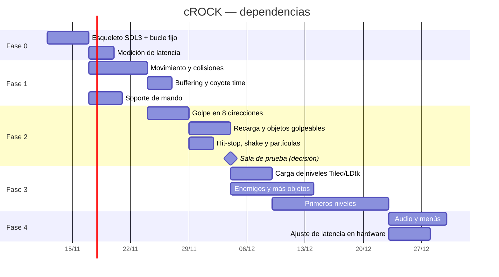

# ROADMAP — cROCK

Platformer 2D de precisión estilo Celeste. Protagonista: un troglodita con una porra.
En lugar del doble salto, el personaje **golpea con la porra contra algo para impulsarse**, eligiendo la dirección del golpe.

---

## 1. Decisiones tomadas

| Tema | Decisión |
|---|---|
| Género | Platformer 2D de precisión, estilo Celeste |
| Mecánica central | Golpe con la porra contra objetos golpeables = impulso (sustituye al doble salto) |
| Prioridad absoluta | Refresco alto e input lag mínimo |
| Librería de ventana/input/audio | **SDL3** (descartado macroquad) |
| Camino crítico | input → simulación → render, **en un solo hilo** |
| Hilos auxiliares | Solo audio, carga de niveles/assets y red (si la hubiera) |
| Motor / ECS | Sin motor genérico ni ECS completo: bucle propio |
| Física | Propia y determinista (colisión AABB, sin motor de física genérico) |
| Lenguaje | **Rust** (crate `sdl3`, SDL compilado desde fuente y enlazado estático) |
| Simulación | 240 Hz fijos, render interpolado |
| Niveles | **Tiled** (`.tmj` JSON), capítulos como listas de salas; solver para comprobar que se pueden pasar |
| Arte | Pixel art a 16 px por tile (doble resolución que la física, que va a 8) |
| Protagonista | **Crock**: cavernícola delgado con melena larga que le cubre el cuerpo (asoman cara, brazos y pies) |

## 2. Mecánica del golpe

- **Impulso opuesto al golpe:** el personaje sale despedido en dirección contraria a la del golpe (golpear abajo lanza arriba, golpear a un lado lanza al otro, etc.).
- **Dirección:** 8 direcciones (legible, justa y reproducible, como el dash de Celeste). Analógico 360° queda como opción a valorar.
- **Objetos golpeables concretos** (rocas, estalactitas, troncos, huesos colgantes, bichos, cuernos de mamut…), para que el lenguaje de niveles sea claro. No todo es golpeable.
- **Recarga:** número limitado de golpes, restaurados al tocar suelo o al golpear ciertos objetos.
- **Variantes a explorar:** rocas que se rompen en un solo uso, objetos con distinto impulso, enemigos que devuelven el golpe, fuego que quema la porra.
- **Pendiente de decidir:** si tras el impacto el jugador puede añadir empuje con el stick (estilo Celeste) o el impulso es siempre exactamente opuesto al golpe. *Prototipo: exactamente opuesto por defecto; `strike_steer` en `tuning.cfg` activa el empuje para comparar jugando.*

## 3. Principios de latencia y "game feel"

1. **Fixed timestep alto** (120–240 Hz de simulación) con render interpolado.
2. **Física determinista y propia**, con constantes de movimiento ajustables en caliente.
3. **Input buffering** (~80–100 ms) y **coyote time**: perdonan sin añadir latencia.
4. **Apuntado instantáneo:** la dirección se lee en el instante del botón, sin animación previa. Como mucho, una ralentización mínima.
5. **Leer el input lo más tarde posible** dentro del frame, justo antes de simular.
6. **Presentación sin cola:** cola de frames a 1, sin triple buffering; vsync adaptativo/VRR, o mailbox/immediate si se tolera tearing.
7. **Pantalla completa exclusiva / direct scanout** para saltarse el compositor.
8. **Frame pacing:** espera precisa hasta justo antes del vblank (spin-wait en los últimos 1–2 ms) en lugar de `sleep`.
9. **Hit-stop** (2–4 frames), screen shake y partículas en el impacto.
10. **Hitbox del golpe generosa** y ventana activa corta.
11. **Reinicio instantáneo** tras morir.
12. **Mando como ciudadano de primera:** gamepad de SDL3 con timestamps por evento, hotplug y compatibilidad con Steam Input.

## 4. Arquitectura

- Módulo de **simulación independiente del framework**: `step(state, input, dt) -> state`.
- Capa fina de plataforma sobre SDL3: ventana, presentación, input, audio.
- Niveles en **Tiled o LDtk**, exportados a un formato simple cargado al inicio.
- Un solo hilo en el camino crítico; el resto de hilos nunca bloquea ni retrasa ese camino.

## 5. Fases

### Fase 0 — Esqueleto
- [x] Proyecto con SDL3 (ventana, bucle propio, timestep fijo, render interpolado)
- [x] Medición de latencia y frame pacing (contador de frame time, modos de presentación)

### Fase 1 — Movimiento base
- [x] Correr, saltar, caer con constantes afinadas *(valores iniciales; falta afinar jugando)*
- [x] Colisiones AABB propias
- [x] Input buffering y coyote time
- [x] Soporte de mando (SDL3 gamepad) *(sin probar con mando físico)*

### Fase 2 — Mecánica del golpe (prototipo)
- [x] Un objeto golpeable e impulso en 8 direcciones
- [x] Recarga de golpes
- [x] Hit-stop, screen shake y partículas básicas
- [x] Sala de prueba con 3–4 tipos de objeto *(roca, frágil, hueso, musgo)*
- [ ] **Punto de decisión:** ¿el golpe encadenado resulta divertido?

### Fase 3 — Contenido
- [x] Carga de niveles desde Tiled/LDtk *(Tiled, `.tmj`; ver docs/NIVELES.md)*
- [x] Más tipos de objeto y enemigos *(escarabajo, murciélago, pinchos, fuego, salidas)*
- [x] Muerte y reinicio instantáneo
- [x] Primeros niveles jugables *(capítulo 1, 5 salas, comprobadas con el solver)*

### Fase 4 — Pulido y publicación
- [ ] Audio con baja latencia
- [ ] Menús, opciones de mando y pantalla
- [ ] Ajuste fino de latencia en hardware real (144 Hz+, VRR)
- [ ] Steam / Steam Deck (si se decide publicar)

## 6. Dependencias entre tareas

> Las fechas son orientativas; lo importante es el orden y las dependencias.

## 7. Preguntas abiertas

- ¿Impulso siempre opuesto al golpe o con empuje adicional del stick?
- ¿8 direcciones o analógico 360°?
- ¿Objetivo de refresco/hardware concreto (144 Hz+, handheld, Steam Deck)?
- ¿Se publica en Steam?
- ¿Power-ups? Propuesta: pocos, temporales y propios de cada sala (porra de mamut, sílex que prende la porra, pluma para planear…); como única mejora permanente, la doble carga de golpe.
